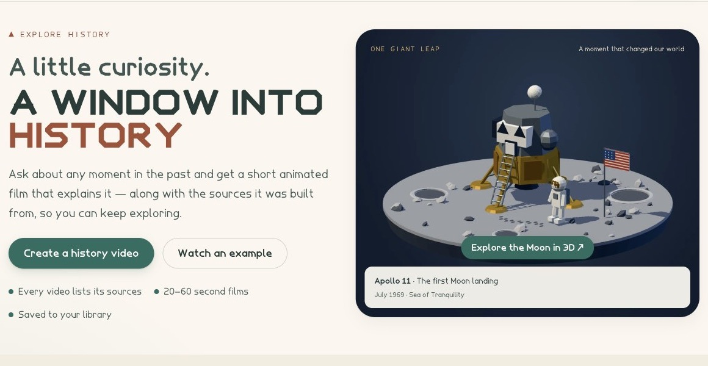
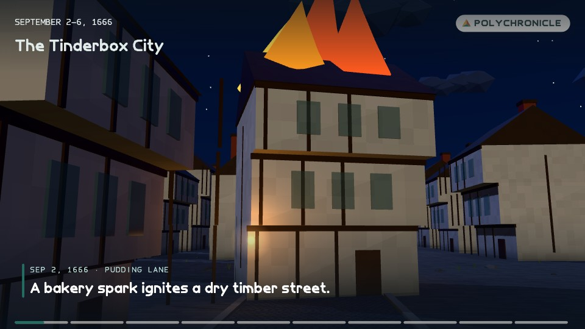
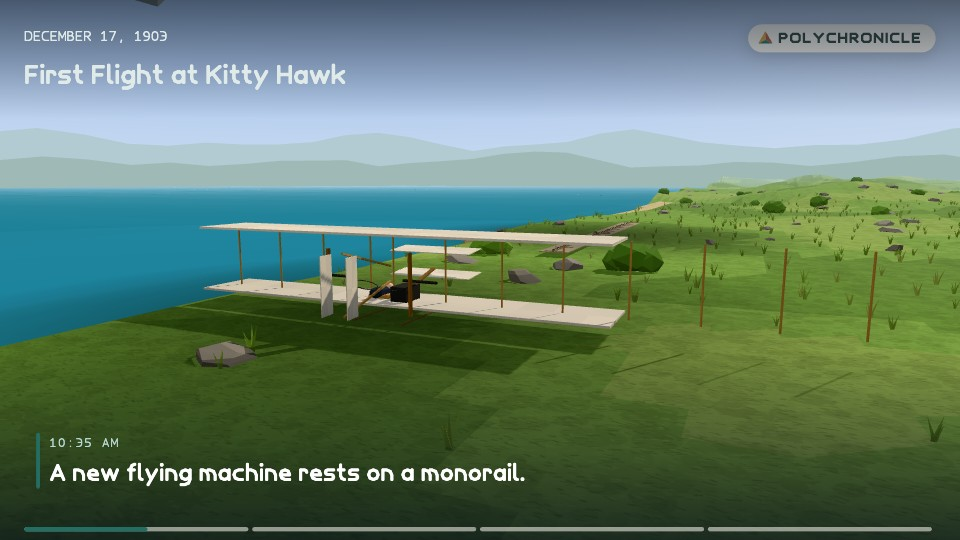
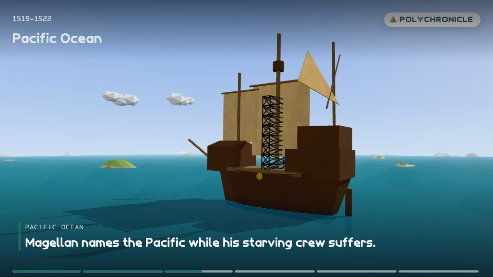
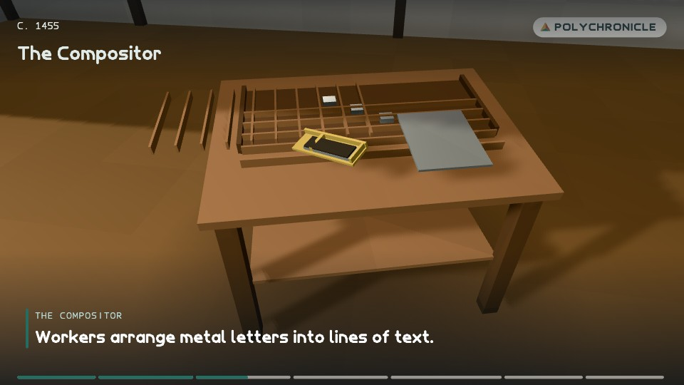
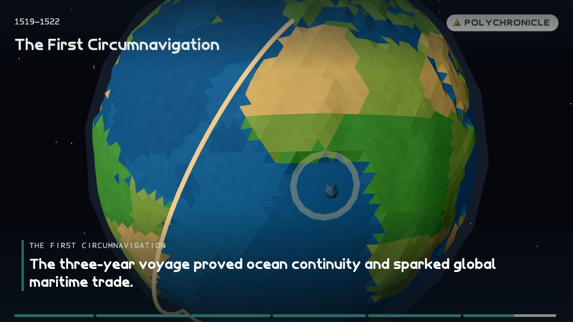
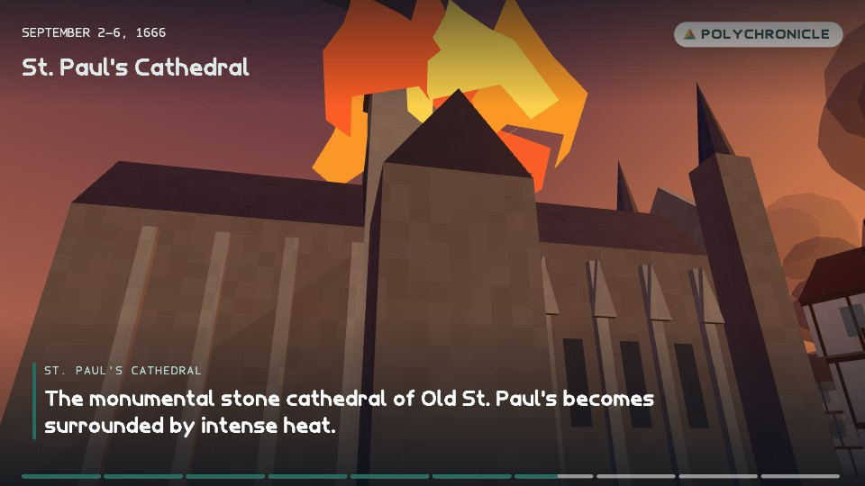
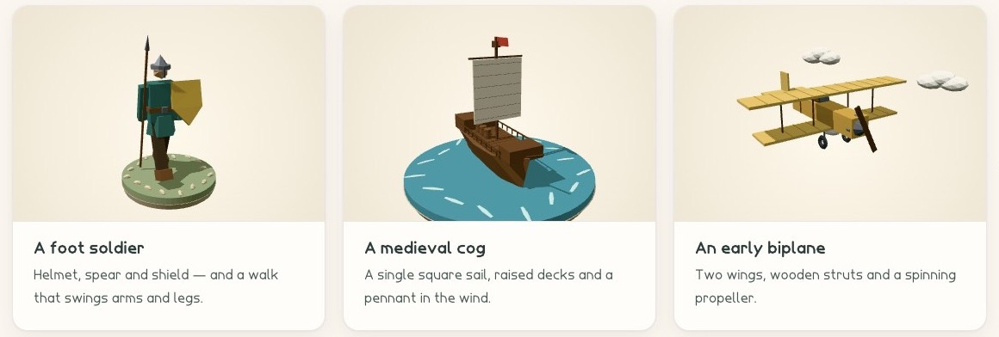
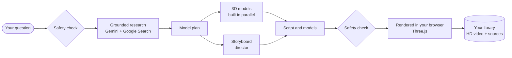
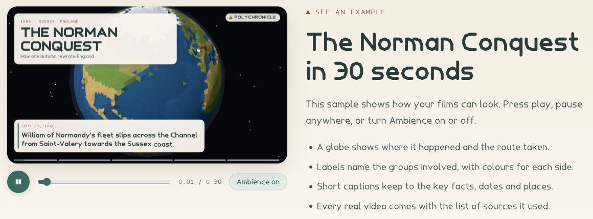

<div align="center">


# PolyChronicle

**A little curiosity. A window into history.**

Ask about any moment in the past and get a 20–60 second low-poly film that explains it.<br />
Every film is researched from public sources, cast with 3D models designed for that event, and animated entirely in code.

<p>
  
  
  
  
  
  
</p>

[Gallery](#gallery) · [How it works](#how-it-works) · [Features](#features) · [Quick start](#quick-start) · [Documentation](#documentation)



</div>

## Gallery

Every frame below was drawn by PolyChronicle's own renderer from a generated script. There is no video model and no stock footage: just geometry, light and type.

<table>
  <tr>
    <td width="33%" valign="top">
      
      <br /><sub><b>The Great Fire of London, 1666.</b> A bakery spark on Pudding Lane.</sub>
    </td>
    <td width="33%" valign="top">
      
      <br /><sub><b>Kitty Hawk, 1903.</b> The Wright Flyer waits on its launch rail.</sub>
    </td>
    <td width="33%" valign="top">
      
      <br /><sub><b>Magellan's voyage, 1519–1522.</b> The fleet crosses the Pacific.</sub>
    </td>
  </tr>
  <tr>
    <td width="33%" valign="top">
      
      <br /><sub><b>Mainz, c. 1455.</b> Metal type set by hand in Gutenberg's workshop.</sub>
    </td>
    <td width="33%" valign="top">
      
      <br /><sub><b>Maps that move.</b> A faceted globe with real coastlines traces the route.</sub>
    </td>
    <td width="33%" valign="top">
      
      <br /><sub><b>Old St Paul's, 1666.</b> The cathedral is surrounded by the fire.</sub>
    </td>
  </tr>
</table>

### A new cast every time

There is no fixed model library. For each film, Gemini designs the people, buildings and vehicles of that time and place as declarative `ModelDefinition`s: primitives, materials, hinged joints and animation channels. They're validated as data, so generated content never runs as code.



## How it works



1. **Check.** The question passes keyword and classifier moderation before anything is made.
2. **Research.** Gemini, grounded with Google Search, writes a short briefing and keeps every source it used.
3. **Plan, build and direct.** A planner lists the models the story needs (up to ten). Every model is built at once while the director writes the storyboard: shots, camera moves, captions, maps and timing. All three steps study the example films in [`references/`](references) as the target look.
4. **Check again.** The finished storyboard is moderated too.
5. **Render.** The browser draws every frame with a deterministic Three.js engine and encodes a 720p, 30 fps MP4 with WebCodecs.
6. **Keep.** The film and a poster image upload in 1 MiB chunks and appear in your library, with the sources listed beside them.

A film usually takes one to three minutes from question to library. The full lifecycle is in [docs/ARCHITECTURE.md](docs/ARCHITECTURE.md).



## Features

- **Research you can check.** Every film is built from a grounded briefing, and its source list stays with the video.
- **A film made in code.** Procedural terrain, water and weather; streets, waterfronts, settlements and interiors; camera moves, captions, transitions and a faceted globe with real coastlines.
- **Rendered and encoded in the browser.** Frames are drawn offscreen and saved as an HD MP4 (WebM as a fallback) with a synthesized ambient soundtrack and a JPEG poster.
- **Safe by design.** Prompts and storyboards both pass moderation, and every decision is written to an audit log that's deleted with the account.
- **Private accounts.** Email and password sign-up with hashed sessions, a private library, HD downloads and full account deletion.
- **An original look.** The Facet, Tessera and Tessera Mono typefaces are generated in this repository from hand-designed glyph skeletons. The UI is warm and friendly, and honours reduced motion everywhere, including WebGL scenes.

### Usage limits

Each account can make **10 videos per day**, and a library holds up to 100 videos. The daily number lives in one place, `SITE.dailyVideos` in [`lib/content/site.ts`](lib/content/site.ts), and the site shows it in the studio, in the message people see when they reach it, and in the Terms. Storage budgets are listed in the [deployment guide](docs/DEPLOYMENT.md#storage-and-retention).

## Tech stack

| Area          | Choice                                                                                                                         |
| ------------- | ------------------------------------------------------------------------------------------------------------------------------ |
| Framework     | Next.js 16 (App Router), React 19, TypeScript                                                                                  |
| 3D and motion | Three.js, React Three Fiber, motion.dev                                                                                        |
| AI            | Google Gemini via `@google/genai`: Gemini 4 Argon creates each film; a Flash model handles grounded research and safety checks |
| Database      | TigerData (managed PostgreSQL) via `pg`                                                                                        |
| Media         | Mediabunny and WebCodecs (MP4, WebM fallback); chunked PostgreSQL storage                                                      |
| Validation    | zod 4, with schemas shared by the server and the browser                                                                       |
| Hosting       | Vercel or any Node.js host                                                                                                     |

## Quick start

**You'll need** Node.js 24 (see `.nvmrc`; 20.9 or later works), a PostgreSQL database (TigerData recommended) and a Gemini API key.

```bash
npm ci
cp .env.example .env.local    # fill in GEMINI_API_KEY, DATABASE_URL, DATABASE_CA_CERT…
npm run db:migrate            # creates or updates the tables (safe to re-run)
npm run dev                   # http://localhost:3000
```

Every environment variable is described in [docs/DEPLOYMENT.md](docs/DEPLOYMENT.md#environment-variables). Run `npm run check` before opening a pull request.

<details>
<summary><b>All npm scripts</b></summary>

| Command                                          | What it does                                                                                                    |
| ------------------------------------------------ | --------------------------------------------------------------------------------------------------------------- |
| `npm run dev` / `build` / `start`                | Next.js development server, production build, production server                                                 |
| `npm run check`                                  | Type check, lint, format check and unit checks: run before every PR                                             |
| `npm run lint` / `format`                        | ESLint (Next.js config) / Prettier                                                                              |
| `npm run test:unit`                              | Schema, model, renderer, soundtrack and redirect-safety checks (no network)                                     |
| `npm run test:audit [-- --live]`                 | Moderation audit and account-deletion checks against the database                                               |
| `npm run test:backend [-- --live]`               | HTTP integration suite against a local server                                                                   |
| `npm run test:film -- script.json`               | Validates a generated script and checks its models animate                                                      |
| `npm run visual:build` / `visual:serve`          | Visual harness: contact sheets, collision audit and timings for films ([guide](tools/visual-harness/README.md)) |
| `npm run bench:builder [-- --films]`             | Live A/B of geometry builder models on one fixed plan ([results](docs/BUILDER_BENCHMARK.md))                    |
| `npm run db:migrate` / `db:check` / `db:inspect` | Apply schema / connectivity check / read-only operator views                                                    |
| `npm run gemini:check`                           | Live check of the Gemini key, model and Search grounding                                                        |
| `npm run secrets:check`                          | Scans commit candidates for configured secrets                                                                  |
| `npm run release:check`                          | Validates the production environment before a deploy                                                            |
| `npm run assets:fonts` / `assets:landmask`       | Regenerate the typefaces / the globe land mask                                                                  |

</details>

<details>
<summary><b>Project structure</b></summary>

```text
app/            Pages, API routes, metadata (robots, sitemap, Open Graph image)
components/     UI components; components/three/ holds the 3D scenes
lib/
  audio/        Synthesized ambience (player) and soundtrack (saved films)
  client/       Browser API client, chunked upload, render-and-save
  content/      Site config, topic ideas, example models, sample reel, landmark reel
  lowpoly/      Renderer: model compiler, engine, layout, environments, globe, overlay
  render/       HD movie export, poster capture and the legacy GIF exporter
  schema/       Shared contracts: VideoScript and ModelDefinition
  server/       Auth, database, Gemini pipeline, model routing, moderation audit, media
  shared/       Isomorphic helpers
  typography/   Generated glyph data
db/             Database schema
docs/           Project documentation; docs/images/ holds the README screenshots
public/         The Facet, Tessera and Tessera Mono typefaces, and static images
references/     Example films attached to every creative Gemini request as the target look
scripts/
  assets/       Font and land-mask generators
  bench/        Live builder-model benchmark
  checks/       Secret scan, release config check, Gemini connectivity check
  db/           Migrations, connectivity check and read-only inspection
  lib/          Helpers shared by the scripts
  tests/        Unit, moderation-audit, backend and generated-film checks
tools/          Developer tools: tools/visual-harness/ renders films for visual QA
types/          Ambient type declarations for untyped packages
tmp/            Local scratch (git-ignored): QA probes, benchmark runs, contact sheets
.builds/        Side builds and TypeScript build info (git-ignored); .next is the default build
```

</details>

## Documentation

| Document                                                                                    | Contents                                                     |
| ------------------------------------------------------------------------------------------- | ------------------------------------------------------------ |
| [Architecture](docs/ARCHITECTURE.md)                                                        | System overview, request lifecycle, data model, code layout  |
| [HTTP API](docs/API.md)                                                                     | Endpoints, payloads, errors and rate limits                  |
| [Renderer](docs/RENDERER.md)                                                                | Script and model formats, compiler, engine, export           |
| [Cinematic renderer](docs/CINEMATIC_RENDERER.md)                                            | Streets, waterfronts, settlements, interiors, shot rig, QA   |
| [Builder benchmark](docs/BUILDER_BENCHMARK.md)                                              | Flash vs Pro geometry builders, run before the Argon default |
| [Safety, privacy and security](docs/SAFETY.md)                                              | Moderation layers, audit log, sessions, data lifecycle       |
| [Design system](docs/DESIGN.md)                                                             | Theme, typefaces, components, motion                         |
| [Deployment and operations](docs/DEPLOYMENT.md)                                             | Environment, Vercel, database, limits, checklist             |
| [Storytelling brief](docs/STORYTELLING.md)                                                  | The original production brief the project started from       |
| [Contributing](CONTRIBUTING.md) · [Security policy](SECURITY.md) · [Agent guide](AGENTS.md) | Workflow, conventions and reporting                          |

## Deploying

PolyChronicle deploys as a single Next.js project, and Vercel works out of the box: import the GitHub repository, add the environment variables, and every push to `main` deploys. GitHub Actions runs a clean install, the code checks, a secret scan, a production dependency audit and a build on every push to `main` and every pull request, without production credentials. Run `npm run release:check` against the target environment first, and apply database migrations as their own step; nothing migrates automatically. The full checklist is in [docs/DEPLOYMENT.md](docs/DEPLOYMENT.md).

## Status and known limitations

- Email verification and password reset aren't implemented yet.
- Rendered media is stored in PostgreSQL, which suits demo scale. Move it to object storage before a public launch.
- Legal pages use placeholder contact and operator details until `NEXT_PUBLIC_CONTACT_EMAIL` and `NEXT_PUBLIC_LEGAL_ENTITY` are set.
- Films are AI-assisted interpretations and can contain mistakes. Every film lists its sources so you can check.

## License

No license has been chosen yet. Until one is added, all rights are reserved by the authors.
