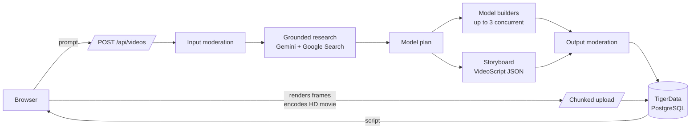

# Architecture

Polyhistor is a single Next.js 16 application (App Router, React 19) with no separate backend. API routes handle accounts, the AI pipeline and storage. The browser renders and encodes each film.



## Request lifecycle

1. **Create.** `POST /api/videos` validates the prompt (8–2000 characters), applies the daily limit, and inserts a `ph_videos` row with status `researching`. The whole provider pipeline shares a 260-second abort signal.
2. **Input moderation.** `moderate()` (`lib/server/gemini.ts`) runs a keyword pre-filter and then a structured Gemini classifier. Every verdict is written to `ph_audit` (see [SAFETY.md](SAFETY.md)).
3. **Research.** Recent sourced research is reused for the same user, prompt and duration within 24 hours, after input moderation. Otherwise Gemini answers with the `googleSearch` tool enabled. Grounding sources are collected (http/https only, up to 20) and stored with the research text. Status becomes `scripting`.
4. **Model planning and building.** Gemini plans 1–4 bespoke models with an explicit complete final silhouette, approximate world dimensions [depth, height, width], major spatial relationships, and an action contract (static, repeating, progressive or mixed) for each object (`lib/server/model-planning.ts`) and builds each as a `ModelDefinition` using reusable construction skills (`lib/server/modeling-skills.ts`). Up to three builders run concurrently with storyboarding; the next model starts when a worker finishes, leaving provider capacity for the director. Definitions are normalized against bounded complexity limits and cached per user. Progressive action contracts require changing keyframes with distinct start and end states; a periodic oscillator cannot satisfy that check. These checks confirm motion representation, not historical accuracy, correct joint selection, or collision-free choreography, which still require rendered review. Tessellation is reduced before structural parts; a builder result that still requires part deletion is retried with the actual validation feedback. Object planning defaults to the creative Pro model; `GEMINI_PLANNER_MODEL` can override it independently of the geometry builders.
5. **Storyboard.** Gemini writes a `VideoScript` constrained by `geminiVideoScriptJsonSchema()`, with element `model` fields limited to the generated model ids. It follows `SCRIPT_AUTHORING_GUIDE` and the storytelling guide (`lib/server/storytelling.ts`). `normalizeVideoScript()` repairs near-misses and fits durations exactly. If shots exceed seven seconds or the director supplied too few shots to fit the requested duration, a bounded fast-model editorial pass splits existing factual beats into shorter coverage before caption fitting and output moderation. Optional `layout` and `shotSize` fields distinguish indoor/open/street settings and wide/medium/close coverage. `structureState` can mark documented architectural aftermath; the generic compiler converts the generated structures into broken walls and settled debris without changing living subjects.
6. **Output moderation.** The script's text (titles, captions, labels and model names) is moderated again before it's saved. Status becomes `ready`.
7. **Render and save (browser).** `lib/client/save.ts` renders every frame offscreen at a fixed timestep with `PolyEngine`, encodes a 720p 30 fps movie with a deterministic stereo ambient soundtrack through Mediabunny/WebCodecs, captures a JPEG poster, and uploads both in 1 MiB chunks. AVC/AAC MP4 is preferred, with VP9/Opus WebM where supported. Completing the movie upload sets status `rendered`.

## Rendering

The renderer is deterministic: the same script and seed always produce the same frames, so a stored script fully describes its film.

| Module                       | Responsibility                                                                                                                                                                              |
| ---------------------------- | ------------------------------------------------------------------------------------------------------------------------------------------------------------------------------------------- |
| `lib/lowpoly/compiler.ts`    | The single interpreter from `ModelDefinition` JSON to Three.js. It expands mirror and repeat copies, bakes static parts into one vertex-coloured mesh per finish, and animates only pivots. |
| `lib/lowpoly/engine.ts`      | `PolyEngine`: builds scenes lazily, lays out formations, frames the camera from real model bounds, and composites the overlay. `renderAt(t)` is a pure function of time.                    |
| `lib/lowpoly/environment.ts` | Procedural terrain per setting, low-poly water, sky dome, sun or moon, clouds, stars and weather.                                                                                           |
| `lib/lowpoly/globe.ts`       | Faceted Earth with real coastlines (1° Natural Earth bitmask in `landmask.ts`), used by map scenes.                                                                                         |
| `lib/lowpoly/overlay.ts`     | Title card, captions with word-by-word reveal, labels, legend, progress rail, faceted transitions and end card, all drawn with the custom fonts.                                            |
| `lib/render/movie.ts`        | HD frame loop, WebCodecs encoding and ambient soundtrack muxing; bounded to 32 MiB.                                                                                                         |
| `lib/render/export.ts`       | Offscreen frame loop with backpressure, stall detection and cancellation; falls back to lower fps if the GIF exceeds 32 MiB.                                                                |
| `lib/render/gif.worker.ts`   | `gifenc` quantization and encoding off the main thread.                                                                                                                                     |

No generated code is ever executed. Models and scripts are plain data validated by zod schemas in `lib/schema/`.

## Code layout

```text
app/                    Routes: pages, API handlers, metadata (robots, sitemap, OG image)
  api/                  auth, videos, chunked media upload/download, health
components/             UI components; components/three/ holds the React Three Fiber scenes
lib/
  client/               Browser API client, chunked uploader, render-and-save flow
  content/              Site config, topic ideas, example models, sample reel
  lowpoly/              Renderer (compiler, engine, environments, globe, overlay, effects)
  render/               HD movie export and legacy GIF worker
  schema/               Shared zod contracts: video.ts (VideoScript), model.ts (ModelDefinition)
  server/               Server-only: auth, db, Gemini pipeline, moderation audit, media, viewer
  shared/               Isomorphic helpers (safe redirect paths)
  typography/           Generated glyph data for the custom typefaces
db/schema.sql           Idempotent schema (npm run db:migrate)
public/fonts/           Facet, Tessera and Tessera Mono (generated by scripts/build-fonts.mjs)
scripts/                Asset builders, migrations, health checks and test scripts
```

## Data model

| Table             | Purpose                                                                                                                                                            |
| ----------------- | ------------------------------------------------------------------------------------------------------------------------------------------------------------------ |
| `ph_users`        | Accounts (scrypt hash, terms version and acceptance time).                                                                                                         |
| `ph_sessions`     | SHA-256 hashes of session tokens with expiry (30 days).                                                                                                            |
| `ph_videos`       | Prompt, status, duration, aspect, research, sources, full script (`plan`), and the ids of the saved movie and poster (legacy columns retain their original names). |
| `ph_assets`       | Uploaded media metadata (MIME type, size, chunk count, SHA-256, completion).                                                                                       |
| `ph_asset_chunks` | Media bytes in chunks of 1 MiB or less.                                                                                                                            |
| `ph_audit`        | Moderation verdicts (stage, outcome, source, reason, text fingerprint).                                                                                            |
| `ph_model_cache`  | Per-user cache of generated model definitions.                                                                                                                     |
| `ph_rate_limits`  | Fixed-window counters.                                                                                                                                             |

Deleting an account cascades through videos, assets, chunks, sessions and the model cache. Audit rows are deleted explicitly in the same transaction (`lib/server/account.ts`).

## Key decisions

- **Code-rendered video, not generative video.** Scenes are reproducible, inexpensive, safe to moderate as text, and editable.
- **Browser rendering.** Serverless functions stay short (no GPU, no long jobs). The movie is encoded where WebGL already runs.
- **HD movies as the stored artifact.** MP4 preserves color, frame rate and ambient sound; WebM is a codec fallback. Existing GIFs remain readable. The poster JPEG keeps library thumbnails light.
- **Media in PostgreSQL.** One managed service for the hackathon scale. Move the chunks to object storage before public scale (see [DEPLOYMENT.md](DEPLOYMENT.md)).
