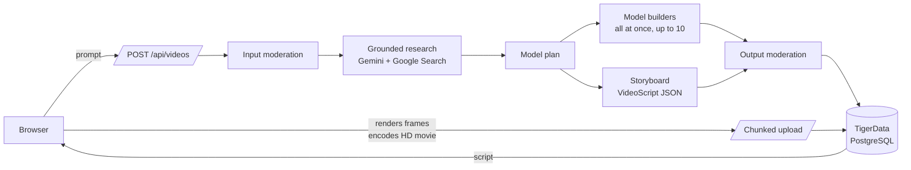

# Architecture

PolyChronicle is a single Next.js 16 application (App Router, React 19) with no separate backend. API routes handle accounts, the AI pipeline and storage. The browser renders and encodes each film.



## Request lifecycle

1. **Create.** `POST /api/videos` validates the prompt (8–2000 characters), allows one video in progress per account (there is no daily cap), and inserts a `ph_videos` row with status `researching`. This request covers moderation, research and the model plan (steps 2–4), then returns the planned model ids. The rest of production runs as separate short requests driven by the browser (`lib/client/produce.ts`): `build` (groups of models), `direct` (the storyboard) and `finish` (assembly). Every step stops itself at 200 seconds (`STEP_DEADLINE_MS`), well inside a 300-second serverless function. Between steps, the plan and the raw storyboard are kept in `ph_videos.plan` while the status is `scripting` (`lib/server/production.ts`), and built models in the per-user model cache.
2. **Input moderation.** `moderate()` (`lib/server/gemini.ts`) runs a keyword pre-filter and then a structured Gemini 3.8 Flash classifier. Every verdict is written to `ph_audit` (see [SAFETY.md](SAFETY.md)).
3. **Research.** Recent research is reused for the same user, prompt and duration within 24 hours, after input moderation. Otherwise Gemini 3.8 Flash has about 12 seconds. It may use Google Search, and it answers from established knowledge when search does not return in time. Grounding sources are collected when present (http/https only, up to 20). A briefing without citations still continues. Status becomes `scripting`.
4. **Model planning and building.** Gemini 3.8 Flash plans up to eight bespoke models for the film, each with its finished silhouette, world dimensions [depth, height, width], spatial relationships and an action (static, repeating, progressive or mixed) (`lib/server/model-planning.ts`). The same model then builds them all at once as `ModelDefinition`s (`POST /api/videos/:id/build`), at the same time as the storyboard is written (`POST /api/videos/:id/direct`). The planner and builder prompts describe the data format, factual accuracy and safety; the look comes from `FILM_FORMAT`. Each stage may use time the earlier stages did not, and none of them can spend what the rest of the film still needs. The whole film still stops at two minutes. The browser does not send a second build or storyboard request either. A model that misses the budget is left out, and the film continues with the models that were built. Definitions are normalized against bounded complexity limits and cached per user. Which model runs each stage is set in `lib/server/models.ts` (see [DEPLOYMENT.md](DEPLOYMENT.md#environment-variables)). The whole film, including the browser encode, is budgeted at two minutes.
5. **Storyboard.** Gemini 3.8 Flash writes a `VideoScript` constrained by `geminiVideoScriptJsonSchema()`, with element `model` fields limited to the planned model ids. It follows `FILM_FORMAT` (`lib/server/film-format.ts`): the picture and the sound are taken from the example films (a grounded, aligned, human-scale world, a slow camera, a clear sun, a quiet musical bed), and the narration is a documentary rather than those films' plots. That means a plain documentary title (never a question), an establishing shot of the real place, third-person narration that teaches one specific, sourced development per shot, a running on-screen clock (`scene.counter`) that can slow down for the decisive minutes and leap across years, returns to places already shown, shots of about 4–7 seconds so captions can be read, and an ending that states what changed. All of it is adapted to the requested topic and aspect. `SCRIPT_AUTHORING_GUIDE` documents what the renderer does with each field. `normalizeVideoScript()` repairs near-misses and fits durations exactly. Only when the shots cannot add up to the requested length within the per-scene bounds does a short second pass re-cut the same beats. Optional `layout` and `shotSize` fields distinguish indoor/open/street settings and wide/medium/close coverage. `structureState` can mark documented architectural aftermath; the generic compiler converts the generated structures into broken walls and settled debris without changing living subjects. The director sets music.mood for the whole film and may set a tone on each shot. An original underscore follows that choice, at one level, under ambience synthesized from each shot's setting, weather, time of day and the models in it. A missing mood is inferred from the story so older films still get a fitting bed.
6. **Assembly and output moderation.** `POST /api/videos/:id/finish` joins the storyboard with the cached models (`assembleFilm()`), validates the film, and moderates its text (titles, captions, labels and model names) before saving. Status becomes `ready`.
7. **Review while rendering (browser and server).** `POST /api/videos/:id/review` (`lib/server/review.ts`) seats every loose part with `settleDetached()` before the film is encoded. The compiler does the same at render time, including mirrored copies the definition cannot store as one position, so a missed joint does not float. The studio does not render a contact sheet or call a vision model; that pass is what used to add a minute. A caller may still send a contact sheet and measured shot problems (`shotIssues()` in `lib/lowpoly/shot-audit.ts`) for a short visual pass. There is one review round per film (`REVIEW_ROUNDS`). Review failures never stop a film; it renders as it stands.
8. **Render and save (browser).** `lib/client/save.ts` renders every frame offscreen at a fixed timestep with `PolyEngine`, encodes a 720p 30 fps movie with a deterministic stereo score and shot ambience, through Mediabunny/WebCodecs, captures a JPEG poster, and uploads both in 1 MiB chunks. AVC/AAC MP4 is preferred, with VP9/Opus WebM where supported. Completing the movie upload sets status `rendered`.

## Rendering

The renderer is deterministic: the same script and seed always produce the same frames, so a stored script fully describes its film.

| Module                                            | Responsibility                                                                                                                                                                                                                                    |
| ------------------------------------------------- | ------------------------------------------------------------------------------------------------------------------------------------------------------------------------------------------------------------------------------------------------- |
| `lib/lowpoly/compiler.ts`                         | The single interpreter from `ModelDefinition` JSON to Three.js. It expands mirror and repeat copies, bakes static parts into one vertex-coloured mesh per finish, and animates only pivots.                                                       |
| `lib/lowpoly/engine.ts`                           | `PolyEngine`: builds scenes lazily, lays out formations, frames the camera from real model bounds, and composites the overlay. `renderAt(t)` is a pure function of time.                                                                          |
| `lib/lowpoly/shot-audit.ts`                       | Pure measurements of rendered shots (overlaps, camera inside a model, subject framing) used by the review.                                                                                                                                        |
| `lib/lowpoly/layout.ts`                           | Keeps placed footprints apart and stops moving units short of anything in their path (lane shift, then clipped travel).                                                                                                                           |
| `lib/lowpoly/environment.ts`                      | Procedural terrain per setting, low-poly water, sky dome, sun or moon, clouds, stars and weather.                                                                                                                                                 |
| `lib/lowpoly/globe.ts`                            | Faceted Earth with real coastlines (1° Natural Earth bitmask in `landmask.ts`), used by map scenes.                                                                                                                                               |
| `lib/lowpoly/overlay.ts`                          | Title card, captions with word-by-word reveal, labels, legend, progress rail, running counter, faceted transitions and end card, all drawn with the custom fonts.                                                                                 |
| `lib/lowpoly/camera.ts`, `world.ts`, `scatter.ts` | Shot rig, street frontage and skyline, and instanced ground detail. See [CINEMATIC_RENDERER.md](CINEMATIC_RENDERER.md).                                                                                                                           |
| `lib/render/movie.ts`                             | HD frame loop (720p, 30 fps), WebCodecs encoding and soundtrack muxing through Mediabunny; bounded to 32 MiB.                                                                                                                                     |
| `lib/render/export.ts`                            | Poster capture (`renderPoster`), plus the legacy GIF exporter used only by the `/dev/export` harness.                                                                                                                                             |
| `lib/render/gif.worker.ts`                        | `gifenc` quantization and encoding off the main thread (legacy GIF path).                                                                                                                                                                         |
| `lib/audio/`                                      | A director-chosen underscore (`music.mood`, per-shot `tone`) at one level, plus ambience from each shot's place, weather and models. `soundtrack.ts` bakes it into saved films; `ambience.ts` plays that same track in time with the live player. |

No generated code is ever executed. Models and scripts are plain data validated by zod schemas in `lib/schema/`.

## Code layout

```text
app/                    Routes: pages, API handlers, metadata (robots, sitemap, OG image)
  api/                  auth, videos, chunked media upload/download, health
  dev/export/           Development-only export harness
components/             UI components; components/three/ holds the React Three Fiber scenes
lib/
  audio/                Synthesized ambience and soundtrack
  client/               Browser API client, chunked uploader, render-and-save flow
  content/              Site config, topic ideas, example models, sample reel, landmark reel
  lowpoly/              Renderer (compiler, engine, layout, camera, environments, world, globe, overlay, effects)
  render/               HD movie export, poster capture, legacy GIF exporter
  schema/               Shared zod contracts: video.ts (VideoScript), model.ts (ModelDefinition)
  server/               Server-only: auth, db, Gemini pipeline, model routing, reference films,
                        model planning, moderation audit, media, viewer
  shared/               Isomorphic helpers (safe redirect paths)
  typography/           Generated glyph data for the custom typefaces
db/schema.sql           Idempotent schema (npm run db:migrate)
public/fonts/           Facet, Tessera and Tessera Mono (generated by scripts/assets/build-fonts.mjs)
references/             films/ (director) and stills/ (planner, builders): the example films to match
scripts/                Node CLI scripts: assets/, bench/, checks/, db/, tests/ and shared lib/
tools/visual-harness/   Browser harness for renderer visual QA
types/                  Ambient declarations for untyped packages
```

## Data model

| Table             | Purpose                                                                                                                                                            |
| ----------------- | ------------------------------------------------------------------------------------------------------------------------------------------------------------------ |
| `ph_users`        | Accounts (scrypt hash, terms version and acceptance time).                                                                                                         |
| `ph_sessions`     | SHA-256 hashes of session tokens with expiry (30 days).                                                                                                            |
| `ph_videos`       | Prompt, status, duration, aspect, research, sources, full script (`plan`), and the ids of the saved movie and poster (legacy columns retain their original names). |
| `ph_assets`       | Uploaded media metadata (MIME type, size, chunk count, SHA-256, completion).                                                                                       |
| `ph_asset_chunks` | Media bytes in chunks of 1 MiB or less.                                                                                                                            |
| `ph_audit`        | Moderation verdicts (stage, outcome, source, reason, text fingerprint).                                                                                            |
| `ph_model_cache`  | Per-user cache of generated model definitions.                                                                                                                     |
| `ph_rate_limits`  | Fixed-window counters.                                                                                                                                             |

Deleting an account cascades through videos, assets, chunks, sessions and the model cache. Audit rows are deleted explicitly in the same transaction (`lib/server/account.ts`).

## Key decisions

- **Code-rendered video, not generative video.** Scenes are reproducible, inexpensive, safe to moderate as text, and editable.
- **Reference-led prompts.** The target comes from example films, not prompt rules (`lib/server/references.ts`, stills kept within a 14 MiB base64 inline budget). The planner, builder and director are not sent those frames inline, so a film stays inside two minutes. The films in `references/films/` are the source of the stills and are not sent inline. `FILM_FORMAT` says what to carry over: the picture and the sound, not the plots. `next.config.ts` traces that folder into the `/api/videos` function so it ships with the deployment.
- **Browser rendering.** Serverless functions stay short (no GPU, no long jobs). The movie is encoded where WebGL already runs.
- **HD movies as the stored artifact.** MP4 preserves color, frame rate and ambient sound; WebM is a codec fallback. Existing GIFs remain readable. The poster JPEG keeps library thumbnails light.
- **Media in PostgreSQL.** One managed service at the current scale. Move the chunks to object storage before public scale (see [DEPLOYMENT.md](DEPLOYMENT.md)).
