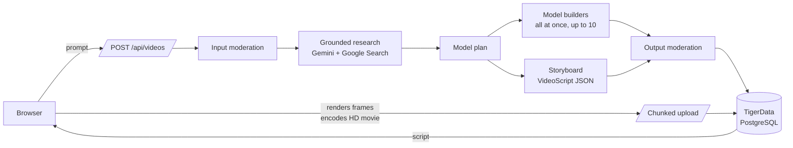

# Architecture

PolyChronicle is a single Next.js 16 application (App Router, React 19) with no separate backend. API routes handle accounts, the AI pipeline and storage. The browser renders and encodes each film.



## Request lifecycle

1. **Create.** `POST /api/videos` validates the prompt (8–2000 characters), applies the daily limit (10 videos per account, `SITE.dailyVideos`), and inserts a `ph_videos` row with status `researching`. The whole provider pipeline shares a 260-second abort signal.
2. **Input moderation.** `moderate()` (`lib/server/gemini.ts`) runs a keyword pre-filter and then a structured Gemini classifier. Every verdict is written to `ph_audit` (see [SAFETY.md](SAFETY.md)).
3. **Research.** Recent sourced research is reused for the same user, prompt and duration within 24 hours, after input moderation. Otherwise Gemini answers with the `googleSearch` tool enabled. Grounding sources are collected (http/https only, up to 20) and stored with the research text. Status becomes `scripting`.
4. **Model planning and building.** Gemini 4 Argon plans up to ten bespoke models for the film, each with its finished silhouette, world dimensions [depth, height, width], spatial relationships and an action (static, repeating, progressive or mixed) (`lib/server/model-planning.ts`), and builds each as a `ModelDefinition`. Every planned model builds at once, concurrently with storyboarding. The prompts describe only the data format, factual accuracy and safety; the look comes from the example films in `references/`, which are attached to the planner, builder and director requests. Each build attempt has 140 seconds. A build that fails validation or runs out of output is retried with the reason (up to three attempts); a build that times out or stalls twice falls back to the fast model. One failed model stops the other builds and the storyboard call. Definitions are normalized against bounded complexity limits and cached per user. Which model runs each stage is set in `lib/server/models.ts` (see [DEPLOYMENT.md](DEPLOYMENT.md#environment-variables)).
5. **Storyboard.** Gemini 4 Argon writes a `VideoScript` constrained by `geminiVideoScriptJsonSchema()`, with element `model` fields limited to the planned model ids. `SCRIPT_AUTHORING_GUIDE` documents what the renderer does with each field. `normalizeVideoScript()` repairs near-misses and fits durations exactly. Only when the shots cannot add up to the requested length within the per-scene bounds does a second pass re-cut the same beats. Optional `layout` and `shotSize` fields distinguish indoor/open/street settings and wide/medium/close coverage. `structureState` can mark documented architectural aftermath; the generic compiler converts the generated structures into broken walls and settled debris without changing living subjects.
6. **Output moderation.** The script's text (titles, captions, labels and model names) is moderated again before it's saved. Status becomes `ready`.
7. **Render and save (browser).** `lib/client/save.ts` renders every frame offscreen at a fixed timestep with `PolyEngine`, encodes a 720p 30 fps movie with a deterministic stereo ambient soundtrack through Mediabunny/WebCodecs, captures a JPEG poster, and uploads both in 1 MiB chunks. AVC/AAC MP4 is preferred, with VP9/Opus WebM where supported. Completing the movie upload sets status `rendered`.

## Rendering

The renderer is deterministic: the same script and seed always produce the same frames, so a stored script fully describes its film.

| Module                                            | Responsibility                                                                                                                                                                              |
| ------------------------------------------------- | ------------------------------------------------------------------------------------------------------------------------------------------------------------------------------------------- |
| `lib/lowpoly/compiler.ts`                         | The single interpreter from `ModelDefinition` JSON to Three.js. It expands mirror and repeat copies, bakes static parts into one vertex-coloured mesh per finish, and animates only pivots. |
| `lib/lowpoly/engine.ts`                           | `PolyEngine`: builds scenes lazily, lays out formations, frames the camera from real model bounds, and composites the overlay. `renderAt(t)` is a pure function of time.                    |
| `lib/lowpoly/layout.ts`                           | Keeps placed footprints apart and stops moving units short of anything in their path (lane shift, then clipped travel).                                                                     |
| `lib/lowpoly/environment.ts`                      | Procedural terrain per setting, low-poly water, sky dome, sun or moon, clouds, stars and weather.                                                                                           |
| `lib/lowpoly/globe.ts`                            | Faceted Earth with real coastlines (1° Natural Earth bitmask in `landmask.ts`), used by map scenes.                                                                                         |
| `lib/lowpoly/overlay.ts`                          | Title card, captions with word-by-word reveal, labels, legend, progress rail, faceted transitions and end card, all drawn with the custom fonts.                                            |
| `lib/lowpoly/camera.ts`, `world.ts`, `scatter.ts` | Shot rig, street frontage and skyline, and instanced ground detail. See [CINEMATIC_RENDERER.md](CINEMATIC_RENDERER.md).                                                                     |
| `lib/render/movie.ts`                             | HD frame loop (720p, 30 fps), WebCodecs encoding and soundtrack muxing through Mediabunny; bounded to 32 MiB.                                                                               |
| `lib/render/export.ts`                            | Poster capture (`renderPoster`), plus the legacy GIF exporter used only by the `/dev/export` harness.                                                                                       |
| `lib/render/gif.worker.ts`                        | `gifenc` quantization and encoding off the main thread (legacy GIF path).                                                                                                                   |
| `lib/audio/`                                      | `soundtrack.ts` renders the deterministic stereo ambience baked into saved films; `ambience.ts` plays live ambience in the player.                                                          |

No generated code is ever executed. Models and scripts are plain data validated by zod schemas in `lib/schema/`.

## Code layout

```text
app/                    Routes: pages, API handlers, metadata (robots, sitemap, OG image)
  api/                  auth, videos, chunked media upload/download, health
  dev/export/           Development-only export harness
components/             UI components; components/three/ holds the React Three Fiber scenes
lib/
  audio/                Synthesized ambience and soundtrack
  client/               Browser API client, chunked uploader, render-and-save flow
  content/              Site config, topic ideas, example models, sample reel, landmark reel
  lowpoly/              Renderer (compiler, engine, layout, camera, environments, world, globe, overlay, effects)
  render/               HD movie export, poster capture, legacy GIF exporter
  schema/               Shared zod contracts: video.ts (VideoScript), model.ts (ModelDefinition)
  server/               Server-only: auth, db, Gemini pipeline, model routing, reference films,
                        model planning, moderation audit, media, viewer
  shared/               Isomorphic helpers (safe redirect paths)
  typography/           Generated glyph data for the custom typefaces
db/schema.sql           Idempotent schema (npm run db:migrate)
public/fonts/           Facet, Tessera and Tessera Mono (generated by scripts/assets/build-fonts.mjs)
references/             Example films attached to the planner, builder and director requests
scripts/                Node CLI scripts: assets/, bench/, checks/, db/, tests/ and shared lib/
tools/visual-harness/   Browser harness for renderer visual QA
types/                  Ambient declarations for untyped packages
```

## Data model

| Table             | Purpose                                                                                                                                                            |
| ----------------- | ------------------------------------------------------------------------------------------------------------------------------------------------------------------ |
| `ph_users`        | Accounts (scrypt hash, terms version and acceptance time).                                                                                                         |
| `ph_sessions`     | SHA-256 hashes of session tokens with expiry (30 days).                                                                                                            |
| `ph_videos`       | Prompt, status, duration, aspect, research, sources, full script (`plan`), and the ids of the saved movie and poster (legacy columns retain their original names). |
| `ph_assets`       | Uploaded media metadata (MIME type, size, chunk count, SHA-256, completion).                                                                                       |
| `ph_asset_chunks` | Media bytes in chunks of 1 MiB or less.                                                                                                                            |
| `ph_audit`        | Moderation verdicts (stage, outcome, source, reason, text fingerprint).                                                                                            |
| `ph_model_cache`  | Per-user cache of generated model definitions.                                                                                                                     |
| `ph_rate_limits`  | Fixed-window counters.                                                                                                                                             |

Deleting an account cascades through videos, assets, chunks, sessions and the model cache. Audit rows are deleted explicitly in the same transaction (`lib/server/account.ts`).

## Key decisions

- **Code-rendered video, not generative video.** Scenes are reproducible, inexpensive, safe to moderate as text, and editable.
- **Reference-led prompts.** The prompts describe only the data format, factual accuracy and safety. The target look comes from the example films in `references/`, which are attached to every creative request (`lib/server/references.ts`, within a 14 MiB base64 inline budget). `next.config.ts` traces that folder into the `/api/videos` function so it ships with the deployment.
- **Browser rendering.** Serverless functions stay short (no GPU, no long jobs). The movie is encoded where WebGL already runs.
- **HD movies as the stored artifact.** MP4 preserves color, frame rate and ambient sound; WebM is a codec fallback. Existing GIFs remain readable. The poster JPEG keeps library thumbnails light.
- **Media in PostgreSQL.** One managed service for the hackathon scale. Move the chunks to object storage before public scale (see [DEPLOYMENT.md](DEPLOYMENT.md)).
