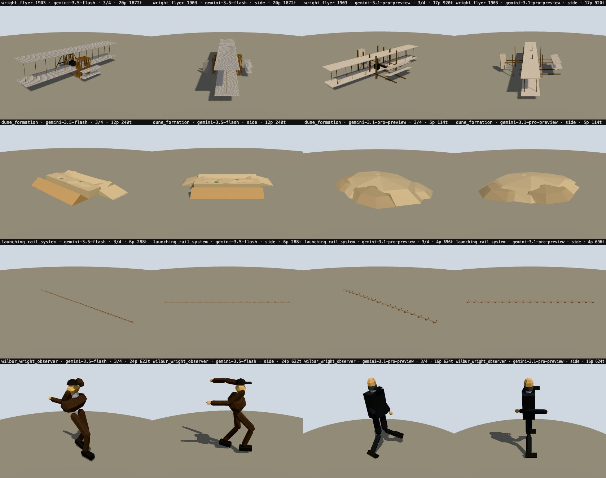

# Builder model benchmark

Which model should build the 3D geometry: the fast default (`gemini-3.5-flash`), or the strongest available (`gemini-3.1-pro-preview`)? Run on 2026-10-24 with `npm run bench:builder -- --films` ([`scripts/bench-builder.ts`](../scripts/bench-builder.ts)).

## Method

For each of three prompts:

1. **Shared steps.** Moderation, research and one model plan run once.
2. **Controlled build.** The same plan (identical model requests) is built once per builder with the production `buildModels`. Only `GEMINI_BUILDER_MODEL` differs, and the planner and director stay `gemini-3.1-pro-preview`.
3. **Full film.** The full pipeline (`writeScript`) runs once per builder, for end-to-end timing.

The prompts were Tower Bridge (a lifting mechanism over a river), Gutenberg's press (an indoor machine) and the Wright brothers (aircraft, figure and natural scenery). Each was a 20 s landscape film. The run used a disposable account that was deleted afterwards, and every prompt passed through `moderate()`.

## Results

| Prompt       | Builder | Build (4 models) | Stalled → Flash fallback | Full film      |
| ------------ | ------- | ---------------- | ------------------------ | -------------- |
| Tower Bridge | Flash   | failed (motion)  | 0                        | failed, 39.7 s |
|              | Pro     | failed (motion)  | 1                        | failed, 85.3 s |
| Gutenberg    | Flash   | failed (motion)  | 0                        | **ok, 64.0 s** |
|              | Pro     | failed (motion)  | 1                        | failed, 57.2 s |
| Wright Flyer | Flash   | **ok, 20.6 s**   | 0                        | failed, 36.0 s |
|              | Pro     | **ok, 62.5 s**   | 0                        | failed, 53.0 s |

All but one of the failures reported "The mechanism animation could not be completed". The model's motion, after the automatic repair step, still failed the pipeline's motion-quality rules (`hasUsefulMotion` / `hasProgressiveMotion`). This happens with **both** builders, so it isn't a builder-quality difference. It is currently the biggest cause of failed generations.

Measured on the Wright plan, the one built successfully by both:

| Metric (mean of 4 models)                          | Flash  | Pro      |
| -------------------------------------------------- | ------ | -------- |
| Build time                                         | 20.6 s | 62.5 s   |
| Parts                                              | 15.5   | 10.5     |
| Triangles                                          | 756    | 589      |
| Animated parts                                     | 2.75   | 3.25     |
| Dimension drift from the plan (0 exact, 0.69 = 2×) | 0.25   | **0.16** |



**What the images show.**

| Model  | Flash                                                                | Pro                                                                                      |
| ------ | -------------------------------------------------------------------- | ---------------------------------------------------------------------------------------- |
| Flyer  | More surface detail; proportions further from the plan (drift 0.115) | A cleaner biplane silhouette with clear struts, and much closer to the plan (drift 0.04) |
| Dune   | Rectangular slabs: the platform defect seen in earlier films         | An organic mound, which is what the plan asked for                                       |
| Rail   | A bare bar                                                           | Adds ties                                                                                |
| Figure | More parts but a crouched, boxy pose                                 | More upright and better proportioned, though in a flat dark costume                      |

## Conclusion

- **Quality:** Pro is better where shape and proportion matter. That's natural forms, landmark silhouettes and structural detail: it follows the size contract more closely with fewer, better-placed parts. Flash yields more parts, but more often the wrong shape.
- **Speed:** Pro builds take about 3× longer (50–62 s against 13–21 s for four models in parallel). In two of three runs one Pro model stalled past the 45 s per-model limit and was rebuilt with Flash, so the "Pro" set was partly Flash. Full films ran 53–85 s with Pro and 36–64 s with Flash. Both fit the 120 s budget in this sample, but Pro has little margin.
- **Reliability** is limited by motion validation, not by the builder. Fix that first, or neither model choice matters.

## Recommendation

1. **Fix the motion stage first.** It failed 9 of 12 runs here. _Fixed since:_ see [Motion repair fix](#motion-repair-fix) below.
2. **Then use a hybrid builder.**
   - **Pro** for `instancePolicy: unique` subjects and natural or architectural backdrops, keeping the 45 s per-model fallback to Flash.
   - **Flash** for figures, props and repeated scenery. Articulated models already have their own setting, `GEMINI_ARTICULATED_MODEL`.
3. **Re-run the benchmark after the motion fix.** Three prompts is a small sample, so compare success rate, total time and the side-by-side sheets again.

## Motion repair fix

The cause was the keyframe units. Asked for a one-way action, the repair model writes keyframe times in milliseconds and values in degrees with `amplitude: 0` (for example `at: 1000, value: -85`). The contract is progress 0–1, a −1…1 multiplier, and the size in `amplitude`. The strict repair schema discarded those channels, so the repaired model still had no one-way motion, and the film failed.

What changed:

- **Normalizer.** `normalizeModelDefinition` rescales keys written in absolute units instead of clamping them flat: times become progress, and the peak moves into `amplitude` unless an explicit amplitude was given. In-contract channels are unchanged.
- **Repair call.** The repair asks for the strict contract but judges each part on its own, so one off-contract channel or unknown part ID no longer discards the whole answer. It gets a second attempt that is told which check failed. It also keeps a part's existing hinge when the answer omits one.
- **No more hard failure.** If motion still falls short, the model is kept (and not cached) rather than failing the film. The log reports `Model motion below target`.
- **Early stop.** One failed model now stops the other builds and the storyboard call.

On six full 20–40 s films from the topic ideas (Magellan, the Sistine Chapel, Marie Curie, the Great Pyramid, the Wright brothers, Gutenberg), all six succeeded in 58–96 s, with no model kept below target.

## Reproduce

```bash
npm run bench:builder -- --films              # live; costs Gemini calls; ~10 min
npm run visual:build && npm run visual:serve
# then open the model comparison for any prompt n of the run:
# http://127.0.0.1:4601/tools/visual-harness/?models=tmp/bench/<run>/models-<n>-gemini-3.5-flash.json&vs=tmp/bench/<run>/models-<n>-gemini-3.1-pro-preview.json
```

Outputs land in `tmp/bench/builder-<stamp>/`. This run's data is `tmp/bench/builder-2026-10-25T02-03-04/` (`summary.txt`, `results.json`, plans, models, films).
